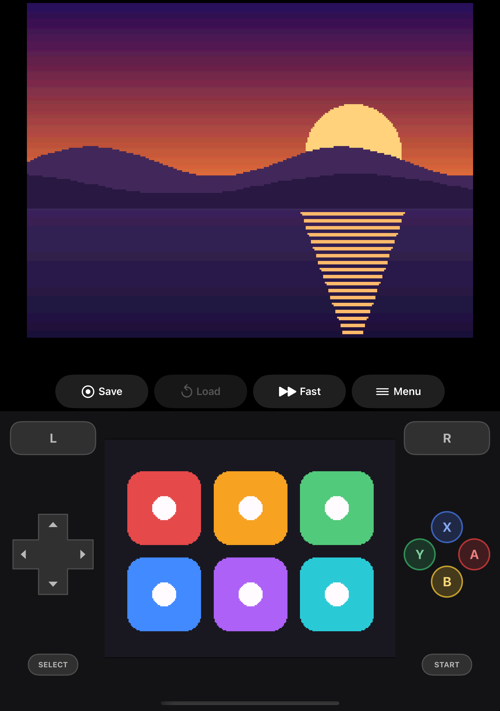
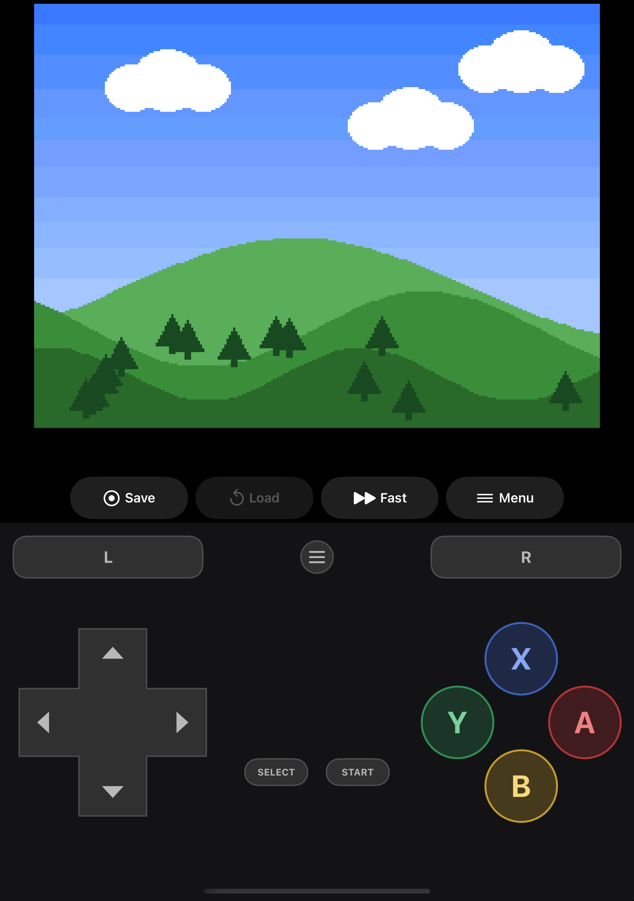
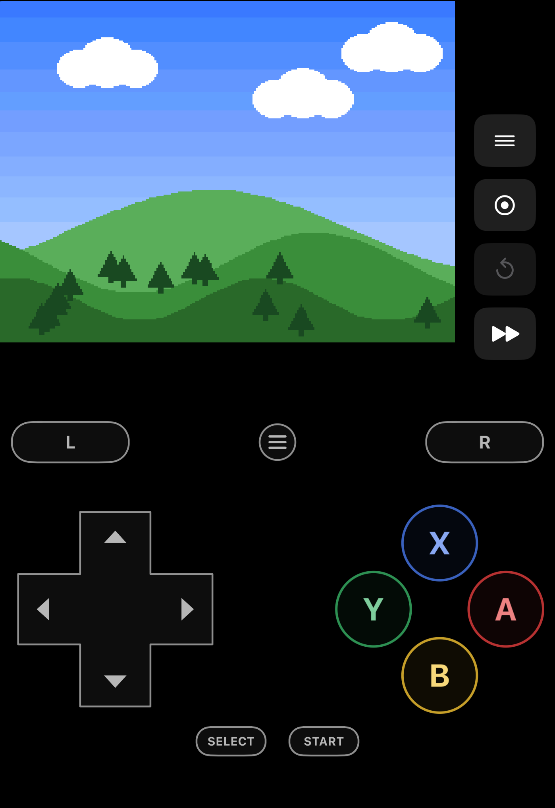
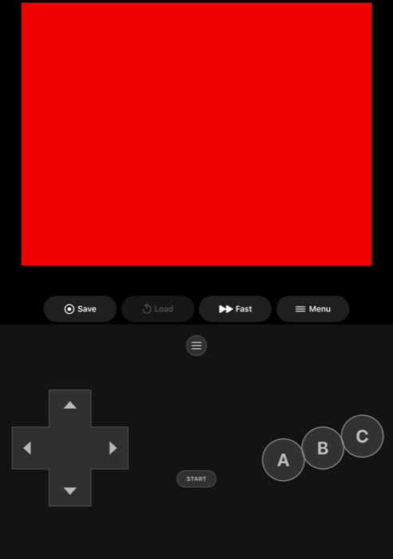
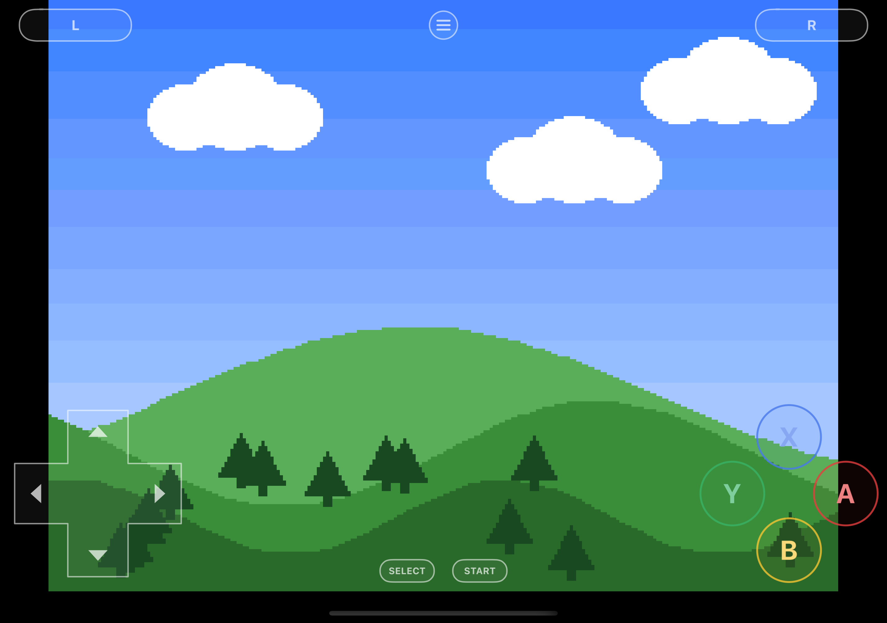
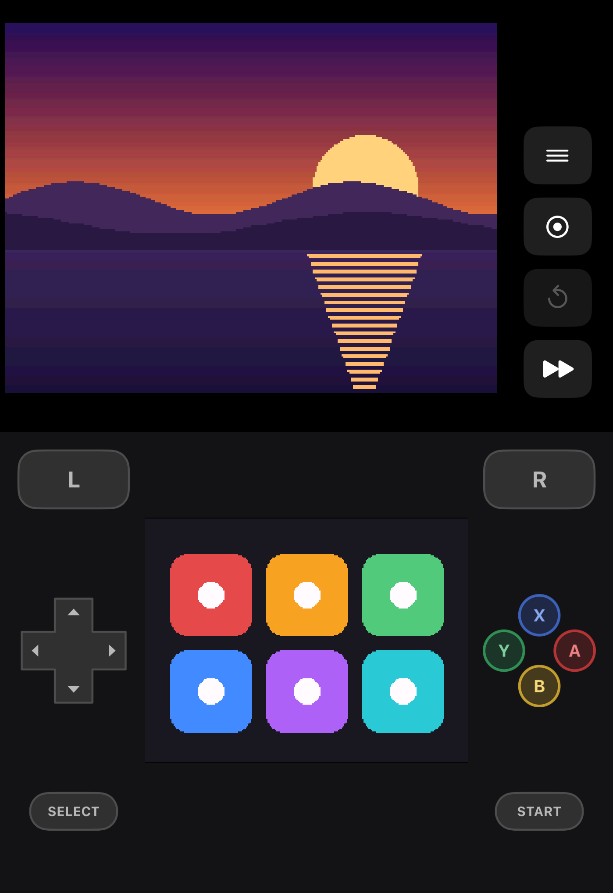
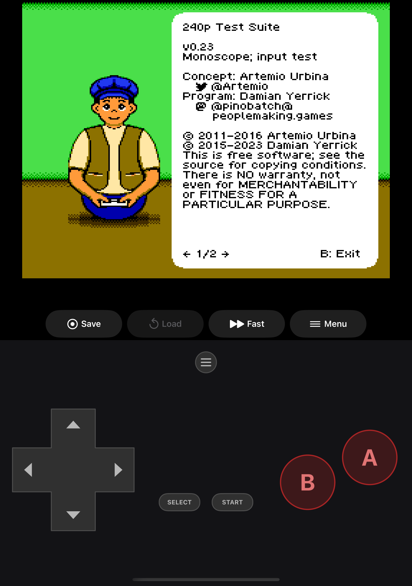
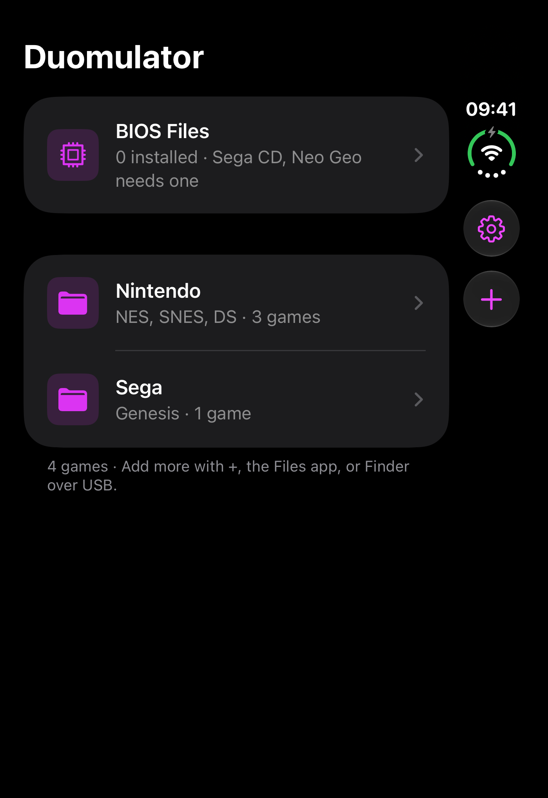
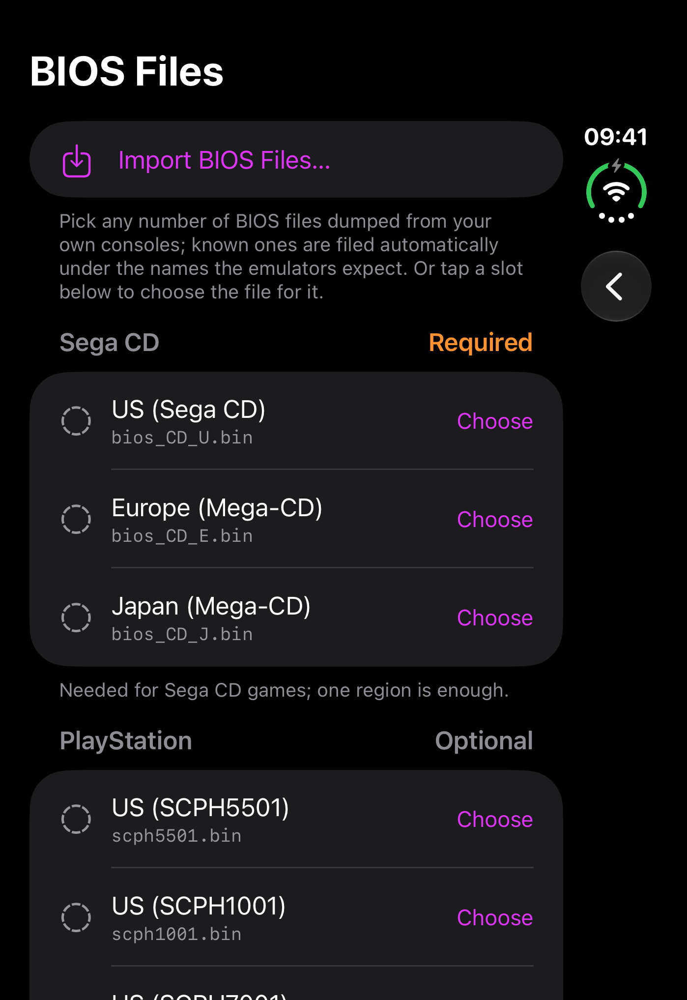

# Duomulator

**A retro game emulator built for iPhone Duo.** Half-fold the phone and it becomes a handheld:
the game on the top screen, a full controller on the bottom. It also works fully open, closed
on the outer display, and on every other iPhone.

<p align="center">
  
  
  
</p>

Duomulator plays SNES, NES, Nintendo DS, Nintendo 64, Genesis / Mega Drive, 32X, Sega CD,
PlayStation and arcade games (Neo Geo, Capcom CPS and thousands more). It includes no
games: bring your own dumps of the cartridges and discs you own.

## Made for the fold

Duomulator follows the hinge and redraws its layout for the way you're holding the phone.

| Half-folded | Fully open | Closed (outer display) |
|:---:|:---:|:---:|
|  |  |  |
| The game sits above the fold and the controller below it, never across the crease. The DS puts its touch screen below the fold, between the d-pad and the face buttons, like the real handheld. | The game fills the screen. Thin outline controls sit over it and fade away while a controller is connected, until you touch the screen. | The quick bar moves into the right-edge strip, where iOS puts its bars on the outer display. The controls stretch across the full width. |

- **Postures come from the hinge.** UIKit's hinge status and the fold's reserved region tell
  the app where the fold is. The game and controls stay out of it, and out of the camera
  regions too.
- **Controls avoid rounded corners.** The app reads the display's real corner radius and
  slides shoulder buttons and face buttons in until they're fully on screen.
- **Override the layout.** In-game menu > Layout forces half-fold or flat. That helps when a
  tray table holds the hinge at an odd angle.

## Systems

| System | Core | Notes |
|---|---|---|
| Super Nintendo | snes9x | `.sfc .smc .swc .fig .bs .st`, also inside `.zip` |
| NES | FCEUmm | `.nes .unf .unif`, `.zip` |
| Nintendo DS | melonDS | Dual-screen layout, touch screen, built-in replacement BIOS (real BIOS optional) |
| Nintendo 64 | Mupen64Plus-Next + GLideN64 | OpenGL ES 3 rendering, analog stick, C buttons |
| Genesis / Mega Drive | PicoDrive | 3- or 6-button pad, chosen per game from a lookup table, with a per-game override |
| 32X | PicoDrive | `.32x`, or `.bin` detected by its header |
| Sega CD | PicoDrive | `.cue` / `.chd`, needs a Sega CD BIOS |
| PlayStation | PCSX ReARMed | `.cue .chd .pbp .m3u`, DualShock analog sticks, multi-disc swapping |
| Arcade | FinalBurn Neo | Neo Geo, Capcom CPS and about 8,500 sets from a built-in catalog, as `.zip` / `.7z` |

All cores run as interpreters (iOS apps can't JIT), statically linked into the app through
the libretro API.

<p align="center">
  
  
  
</p>

## Features

- **Library by manufacturer:** Nintendo, Sega, Sony and Arcade, then system, then game.
  Each list starts with the games you played most recently.
- **Artwork:** title screens are captured on the device from your own games. Builds made
  from source can also download box art from the community libretro-thumbnails collection
  (optional, off by default). The App Store build leaves this out.
- **Save states:** quick save and load from the bar under the game, three slots in the
  menu, and an automatic resume point when you leave a game. Battery saves are kept per
  system.
- **Fast forward,** toggled from the quick bar.
- **Controllers:** MFi, Xbox and PlayStation pads, plus a hardware keyboard. Buttons map
  by position, and you can remap them per system under Settings > Controller Mapping.
- **Touch controls** drawn for each system: SNES colors, the NES's two red buttons, the
  Genesis six-button layout, PlayStation analog sticks, and the N64's C buttons and Z
  trigger. Every finger is tracked, so you can slide between buttons and press diagonals
  like on a real pad.
- **BIOS Files** sits at the top of the library. Import BIOS files there, or pick the file
  for a specific slot. Known dumps are recognized by checksum and filed under the name the
  core expects.
- **Demo games:** three small public-domain games (SNES, Genesis and DS) are added on first
  launch so there's something to play right away. Settings › Add Demo Games restores them.
- **Multi-disc games:** an `.m3u` playlist is written automatically, and you swap discs
  from the menu.

## Adding games

1. Copy ROMs into **Duomulator › ROMs** in the Files app, use **+** in the library, or drag
   them in from Finder over USB. Games go directly in the ROMs folder, not in subfolders.
2. For Sega CD, Neo Geo, or more accurate PlayStation and DS emulation, open **BIOS Files**
   and import the BIOS dumped from your own hardware.

Only play games and BIOS files you have the right to use.

## Building

Requirements:

- **Xcode 27.1 or later.** Its iOS 27.1 SDK has the hinge and reserved-region APIs. The app
  still deploys to iOS 26, and those APIs are availability-checked.
- **[XcodeGen](https://github.com/yonaskolb/XcodeGen).** The Xcode project is generated
  from `project.yml`.

```sh
xcodegen generate
open Duomulator.xcodeproj
```

Set your team under Signing & Capabilities and run it on a device or an iPhone Duo
simulator (Device Hub can fold and unfold the simulator). From the command line:

```sh
xcodebuild -project Duomulator.xcodeproj -scheme Duomulator \
  -destination 'platform=iOS Simulator,name=iPhone Duo' -derivedDataPath build build
```

The first build compiles all seven cores and takes a while. Later builds are incremental.

### Tests

```sh
xcodebuild test -project Duomulator.xcodeproj -scheme Duomulator \
  -destination 'platform=iOS Simulator,name=iPhone Duo' -derivedDataPath build \
  -collect-test-diagnostics never
```

The suite boots real cores against small homebrew test ROMs in `Tests/Fixtures`. It also
covers controller geometry, posture layouts, the library, BIOS import and artwork matching.

### Debug launch arguments

Debug builds accept a few launch arguments for testing and screenshots:

| Argument | Effect |
|---|---|
| `-autolaunchROM <file>` | Open a game from Documents/ROMs at launch |
| `-openLibraryFolder <system \| bios>` | Open a system's game list, or BIOS Files |
| `-postureOverride forceTent \| forceFlat` | Force a layout |
| `-debugPosture closed` | Lay out as on the outer display |
| `-layoutIgnoresGamepads YES` | Keep touch controls visible (the Simulator forwards the Mac's gamepads) |

## Project layout

```
App/
  Duo/        Posture monitor, game screen, layouts, quick bar, in-game menu
  Input/      Touch controller geometry and drawing, gamepads, remapping
  Library/    SwiftUI library, BIOS, artwork, settings, acknowledgements
  Shared/     Systems, input hub, frame and audio buffers, paths
  Video/      Metal renderer
  Audio/      AVAudioEngine output
Core/         libretro host (EmulatorCore), per-core function tables, OpenGL ES for N64
CoreBuild/    Per-core symbol-renaming headers and export lists
Vendor/       The emulator cores (versions and local patches in Vendor/README)
Tests/        Unit and core tests, fixtures
tools/showcase/  Generators for the public-domain showcase ROMs used in these screenshots
docs/         Screenshots and App Store images
```

[ARCHITECTURE.md](ARCHITECTURE.md) covers the data flow, the iPhone Duo APIs and how each
posture is laid out.

## Screenshots

Every screenshot shows homebrew, never a commercial game:

- **SNES, Genesis and DS:** small public-domain showcase ROMs generated by the scripts in
  `tools/showcase`.
- **NES:** Damian Yerrick's GPL-licensed
  [240p Test Suite](https://github.com/pinobatch/240p-test-mini).

Store-ready images live in `docs/app-store`: `iphone-6.3` (1206×2622, Dynamic Island medium
display), `iphone-6.9` (1320×2868, large display) and `iphone-duo` (half-fold and outer
display).

## Privacy

Duomulator collects no data: no accounts, analytics or tracking. Games and saves stay on the
device. The App Store build makes no network requests; builds made from source can
optionally download box art. See the
[privacy policy](https://airdamien.github.io/duomulator/privacy.html).

## License and credits

The emulation cores keep their own licenses:

- **GPL:** FCEUmm, melonDS, PCSX ReARMed, Mupen64Plus-Next and GLideN64.
- **Non-commercial:** snes9x, PicoDrive and FinalBurn Neo.

Each core's license, source link and full text are in the app under Settings >
Acknowledgements. Because of the non-commercial licenses, Duomulator is free and will stay
that way: no price, ads, in-app purchases or donations.

Nintendo, Super Nintendo, Nintendo 64 and Nintendo DS are trademarks of Nintendo. Sega,
Genesis, Mega Drive, 32X and Sega CD are trademarks of Sega. PlayStation is a trademark of
Sony Interactive Entertainment. Neo Geo is a trademark of SNK. iPhone is a trademark of
Apple. Duomulator isn't affiliated with or endorsed by any of them.
